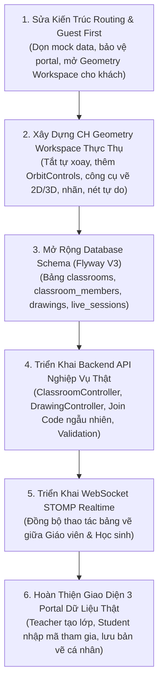

# BÁO CÁO TOÀN DIỆN: PRODUCT & BACKEND AUDIT (CH EDTECH)

**Thời điểm kiểm tra:** 07/11/2026  
**Người thực hiện:** Đội ngũ Kỹ sư Trưởng CH EdTech  
**Mục tiêu:** Rà soát thực trạng toàn diện, vạch rõ các khiếm khuyết giữa thiết kế ban đầu và mã nguồn hiện tại, định hình kế hoạch tái cấu trúc theo triết lý **Guest First**, **Digital Geometry Board** và **Classroom Collaboration**.

---

## I. TRẢ LỜI 10 CÂU HỎI CỐT LÕI CỦA MASTER PROMPT

### 1. Vì sao trang học sinh chưa phân biệt được Guest và người đăng nhập?
- **Nguyên nhân kỹ thuật:** Tuyến đường `/student` trong `apps/web/src/App.tsx` được khai báo là route công khai không có Route Guard / Auth Guard:
  ```tsx
  <Route path="/student" element={<StudentDashboard />} />
  ```
- Component `StudentDashboard.tsx` hoàn toàn không đọc trạng thái đăng nhập từ `useAuthStore`.
- Bất kỳ khách vãng lai nào click vào link trên thanh điều hướng `Navbar.tsx` đều được điều hướng trực tiếp vào màn hình này mà không bị chặn hay chuyển hướng.

### 2. Vì sao giao diện đang hiển thị bài tập và dữ liệu cá nhân khi chưa đăng nhập?
- **Nguyên nhân kỹ thuật:** Toàn bộ nội dung trong `StudentDashboard.tsx` là HTML/JSX tĩnh được hardcode trực tiếp:
  - Badge `"ROLE_STUDENT Active"` (dòng 20-22) hiển thị vô điều kiện.
  - Các bài tập: `"Bài tập tuần 8: Thiết diện hình chóp - Chưa nộp"`, `"Luyện tập: Khoảng cách giữa 2 đường chéo nhau - 10/10"` (dòng 75-88) là chuỗi văn bản cố định.
- Không hề có API call lấy danh sách bài tập hay kết quả học tập từ cơ sở dữ liệu.

### 3. Những chức năng nào hiện chỉ là giao diện (Mock / Chết)?
| Phân hệ / Màn hình | Chức năng hiển thị | Thực trạng kỹ thuật |
|---|---|---|
| **Student Portal** | Badge "ROLE_STUDENT Active" | Hardcoded text trong JSX |
| **Student Portal** | Danh sách bài tập, hạn nộp, điểm số 10/10 | Hardcoded text, không có bảng DB hay API |
| **Student Portal** | Hộp "Hỏi Trợ Lý AI" & Nút gửi câu hỏi | Nút bấm không có `onClick`, không kết nối LLM |
| **Teacher Portal** | Danh sách đề thi "CHỜ DUYỆT" & "ĐÃ DUYỆT" | Hardcoded text, không có bảng đề thi |
| **Teacher Portal** | Nút "Tạo Bài Giảng Mới", "Soạn Đề Kiểm Tra" | Nút bấm không gắn sự kiện xử lý |
| **Teacher Portal** | Danh sách "Lớp Phân Công" (35 HS, 42 HS) | Hardcoded text, không có bảng lớp học |
| **Admin Portal** | Thống kê số lượng người dùng, đề thi tồn | Hardcoded text ("3 Tài khoản", "0 Đề thi") |
| **Admin Portal** | Nút phê duyệt đề thi | Chưa có logic hoặc API |
| **3D Canvas** | Thẻ tính thể tích ($14.58\text{ cm}^3$, $22.50\text{ cm}^3$) | Hardcoded text trong JSX, không tính toán động |

### 4. Backend hiện có những API nào thực sự hoạt động?
Qua rà soát mã nguồn `apps/api/src/main/java/com/chedtech/api/` và kiểm thử qua HTTP:
1. `GET /api/health` $\rightarrow$ **Hoạt động tốt:** Kiểm tra kết nối thật đến PostgreSQL, pgvector 0.8.7, MinIO 2 buckets, JVM.
2. `POST /api/auth/login` $\rightarrow$ **Hoạt động tốt:** Xác thực email/mật khẩu, kiểm tra mã băm BCrypt, sinh JWT token chuẩn HMAC-SHA512.
3. `GET /api/geometry/models` & `POST /api/geometry/models` $\rightarrow$ **Hoạt động CRUD thô:** Lưu và lấy bản ghi `geometry_models`.
4. `POST /api/storage/upload` & `GET /api/storage/download-url/{fileId}` $\rightarrow$ **Hoạt động tốt:** Lưu file lên MinIO, cấp Pre-signed URL có kiểm tra quyền sở hữu IDOR.
5. **Chưa có trên Backend:**
   - Chưa có API Lớp học (`ClassroomController`: Tạo lớp, sinh mã tham gia ngẫu nhiên, học sinh tham gia lớp).
   - Chưa có API Bản vẽ có cấu trúc (`DrawingController`: Lưu, mở, đổi tên, phân quyền bản vẽ).
   - Chưa có API Bài tập (`AssignmentController`).
   - Chưa có API Đề thi & Phê duyệt (`ExamController`).
   - Chưa có WebSocket STOMP endpoint (`/ws-geometry`).
   - Chưa có AI Agent service.

### 5. Geometry Engine hiện tại có thực sự cho phép dựng hình hay chỉ render các mô hình cố định?
- **Thực trạng:** Hoàn toàn chỉ render mô hình cố định dựng sẵn.
- Component `GeometryViewer3D.tsx` tạo trực tiếp `THREE.ConeGeometry(2.5, 3.5, 4)` và `THREE.BoxGeometry(3, 2.5, 3)`.
- Người dùng chỉ có thể bấm nút chuyển giữa hình chóp và hình hộp.
- Không hề có công cụ chọn đỉnh, thêm điểm, vẽ đường, vẽ mặt phẳng, thêm nhãn, kéo thả tọa độ, hay vẽ tự do.
- Frontend thậm chí **chưa cài đặt hoặc import package `@ch-edtech/geometry-core`**!

### 6. Camera 3D có đang tự động xoay không? Thành phần nào gây ra hành vi đó?
- **Có, camera/mô hình bị tự động xoay liên tục.**
- **Thành phần gây ra:** Trong `GeometryViewer3D.tsx`:
  - Dòng 14: `const [isRotating, setIsRotating] = useState(true);` (Mặc định bật tự xoay).
  - Dòng 103-105 trong `animate()`:
    ```ts
    if (meshRef.current && isRotating) {
      meshRef.current.rotation.y += 0.008;
    }
    ```
  - Chưa hề có `OrbitControls` để người dùng giữ chuột trái xoay, giữ chuột giữa pan, cuộn chuột zoom.

### 7. Có thể phát triển bảng vẽ 2D/3D trên kiến trúc hiện tại hay cần tái cấu trúc module?
- **Cần tái cấu trúc thành một phân hệ riêng biệt: `CH Geometry Workspace` (`/board` hoặc `/workspace`).**
- Kiến trúc hiện tại chỉ là một component viewer nhỏ gắn trong dashboard. Bảng vẽ giáo dục cần:
  - Không gian toàn màn hình (Full-screen Workspace) ưu tiên diện tích vẽ.
  - Hệ thống dữ liệu hình học có cấu trúc (Entity-based: Points, Lines, Segments, Rays, Planes, Polygons, 3D Solids, Freehand Strokes, Labels, Constraints).
  - Thanh công cụ vẽ phân nhóm trực quan (Toolbar).
  - Bảng thuộc tính đối tượng được chọn (Properties Inspector).
  - Hệ thống Layers & Bước trình bày (Step Timeline).
  - Phân tách rõ ràng giữa **Chế độ Vẽ (Draw Mode)** và **Chế độ Quan sát (Orbit/View Mode)** kèm View Gizmo.

### 8. Database hiện có đủ cấu trúc để quản lý lớp học, bản vẽ và phiên học chưa?
- **Chưa đủ.** Cơ sở dữ liệu hiện chỉ có 8 bảng:
  `users`, `courses`, `geometry_models`, `files_metadata`, `audit_logs`, `knowledge_documents`, `document_chunks`, `flyway_schema_history`.
- Cần bổ sung ngay qua Flyway Migration V3:
  1. `classrooms`: `id`, `teacher_id`, `name`, `description`, `subject`, `grade_level`, `join_code` (unique, unguessable), `status`, `created_at`, `updated_at`.
  2. `classroom_members`: `id`, `classroom_id`, `student_id`, `joined_at`, `status`.
  3. `drawings`: `id`, `owner_id`, `classroom_id` (nullable), `title`, `description`, `data_json` (chứa toàn bộ entities, layers, steps), `thumbnail_url`, `visibility`, `version`, `created_at`, `updated_at`.
  4. `live_sessions`: Quản lý phiên học tương tác trực tuyến thời gian thực.

### 9. Có thể triển khai WebSocket và đồng bộ bảng vẽ như thế nào?
- **Giải pháp kiến trúc chuẩn:**
  1. **Backend:** Bổ sung `spring-boot-starter-websocket`. Cấu hình STOMP broker tại `/ws-geometry`.
  2. Kênh phát sóng: `/topic/classroom/{classroomId}/board`.
  3. Prefix nhận lệnh: `/app/classroom/{classroomId}/board/action`.
  4. **Payload đồng bộ (Drawing Operation Protocol):**
     - `ADD_ENTITY` (thêm điểm, đoạn thẳng, hình đa diện, nét vẽ).
     - `UPDATE_ENTITY` (thay đổi tọa độ, màu sắc, ẩn/hiện).
     - `DELETE_ENTITY` (xóa đối tượng).
     - `SYNC_STATE` (đồng bộ toàn bộ bảng vẽ khi học sinh mới tham gia).
     - `PERMISSION_CHANGE` (giáo viên khóa bảng hoặc cho phép học sinh vẽ).
  5. **Frontend:** Tích hợp `@stomp/stompjs` để kết nối WebSocket mượt mà, phản ánh tức thì các thao tác giữa trình duyệt của Giáo viên và Học sinh.

### 10. Những vấn đề nào cần sửa trước để tránh phát triển thêm trên nền tảng chưa ổn định?
1. **Dọn sạch toàn bộ Mock Data:** Loại bỏ dứt điểm các dữ liệu giả lập bài tập, đề thi trên giao diện khi chưa đăng nhập.
2. **Triển khai kiến trúc Guest-First:** Khách truy cập vào trang chủ có thể mở ngay **Geometry Workspace** để vẽ, dựng hình 2D/3D, tính toán mà không bị ép đăng nhập.
3. **Phân định rõ ràng Auth Guard:** Tuyến đường `/student`, `/teacher`, `/admin` bắt buộc phải đăng nhập đúng vai trò; nếu chưa đăng nhập sẽ chuyển hướng hoặc hiển thị màn hình hướng dẫn kèm nút đăng nhập.
4. **Xây dựng CH Geometry Workspace thực thụ:** Tích hợp OrbitControls bằng chuột, tắt tự xoay, hỗ trợ đặt điểm, vẽ đoạn thẳng, hình đa diện, nhãn, nét vẽ tự do.
5. **Mở rộng Database & Backend API cho Classroom và Drawing:** Tạo các bảng qua Flyway, triển khai đầy đủ Controller, Service, Repository cho lớp học và bản vẽ.
6. **Triển khai WebSocket Realtime:** Đồng bộ bảng vẽ thời gian thực giữa Giáo viên và Học sinh.

---

## II. KẾ HOẠCH TRIỂN KHAI THEO THỨ TỰ ƯU TIÊN



